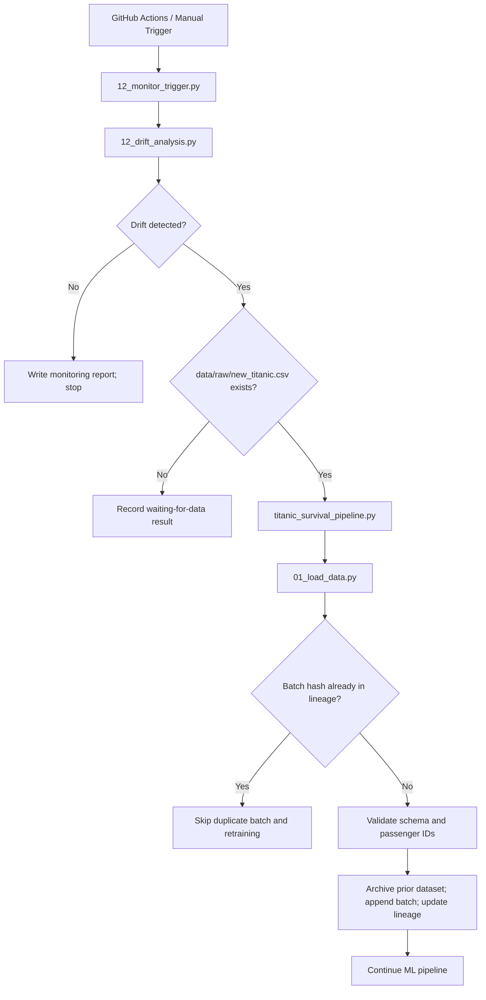
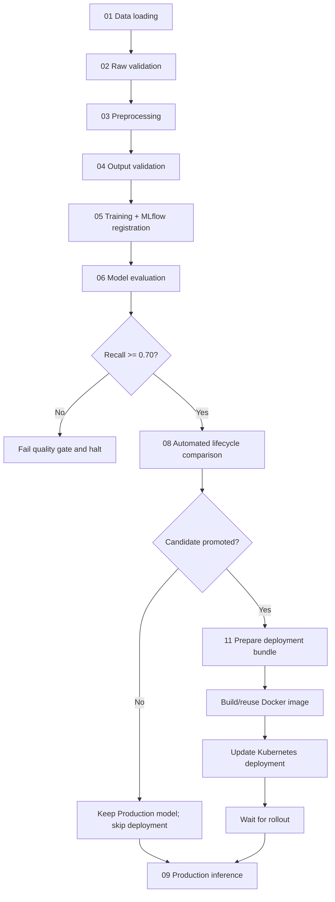

# Titanic Passenger Survival Prediction — End-to-End MLOps Platform

An end-to-end Machine Learning Operations (MLOps) project for predicting Titanic passenger survival, integrating foundational pipeline stages (Labs 1–6) with production pipeline engineering, CI/CD, failure recovery, FastAPI serving, containerization, Kubernetes manifests, drift monitoring, continuous retraining, and lineage tracking (Labs 7–13).

---

## Table of Contents

- [Project Overview](#project-overview)
- [Objectives](#objectives)
- [Key Capabilities](#key-capabilities)
- [Architecture](#architecture)
- [End-to-End Workflow](#end-to-end-workflow)
- [Dataset and Ingestion Rules](#dataset-and-ingestion-rules)
- [Model Evaluation and Lifecycle Policy](#model-evaluation-and-lifecycle-policy)
- [Technology Stack](#technology-stack)
- [Repository Layout](#repository-layout)
- [Environment Setup](#environment-setup)
- [Running the System](#running-the-system)
- [GitHub Actions Automation](#github-actions-automation)
- [Model Serving and Deployment](#model-serving-and-deployment)
- [Important Reports and Artifacts](#important-reports-and-artifacts)
- [Verified Integration Results](#verified-integration-results)
- [Documentation](#documentation)

---

## Project Overview

This repository builds a complete MLOps workflow around the Titanic Passenger Survival dataset (`data/raw/titanic.csv`). It preserves the modular Lab 1–6 scripts (`src/` and `pipelines/`) while providing the integrated Labs 7–13 MLOps platform (`src/mlops_pipeline/`, `api/`, `deployment/`, `k8s/`, `tests/`, `.github/workflows/`, and `docs/`).

A central design principle is that **a successfully trained model is not automatically a Production model**. Every candidate must pass raw schema validation, processed-output validation, and the configured recall quality gate (`>= 0.70`), and then outperform the current `Production` model in the MLflow Model Registry before deployment is permitted.

## Objectives

- Validate raw Titanic datasets and processed feature matrices using Pandera and output assertions.
- Maintain a fixed held-out test split (`data/processed/test_passenger_ids.csv`) across incoming data batches.
- Share deterministic feature engineering (`Title`, `FamilySize`, `IsAlone`) across training, retraining, drift checks, and FastAPI inference (`api/preprocessing.py`).
- Track experiments, hyperparameters, metrics, preprocessor lineage, and registered versions in MLflow (`Titanic_Survival_Production_Model`).
- Enforce a recall quality gate (`>= 0.70`) and automated champion-challenger lifecycle promotion.
- Track incoming dataset batches by SHA-256 hash and lineage (`data/raw/archive/dataset_lineage.json`), preventing duplicate ingestion.
- Detect data drift, prediction drift, and concept drift, and conditionally trigger retraining (`12_monitor_trigger.py`).
- Verify fail-fast validation and MLflow Production recovery via automated failure injection (`10_failure_injection.py`).
- Serve Production predictions through a FastAPI service (`api/main.py`) with Pydantic validation, standardized errors, JSONL inference logging, Docker containerization, and Kubernetes manifests.

## Key Capabilities

| Capability | Implementation |
|---|---|
| Raw-data validation | Strict Pandera schema (`src/mlops_pipeline/validation.py` & `src/validate_data.py`) |
| Reproducible preprocessing | Shared cleaning/feature engineering (`api/preprocessing.py`) + scikit-learn `ColumnTransformer` + fixed test split |
| Experiment tracking & Registry | MLflow tracking & `Titanic_Survival_Production_Model` registry |
| Quality gate | Configured minimum recall of `0.70` (`config.yaml`) |
| Lifecycle decisions | Candidate-vs-Production comparison on recall (`08_automate_lifecycle.py`) |
| Dataset versioning & idempotency | SHA-256 batch hashes, archived snapshots (`data/raw/archive/`), `dataset_lineage.json` |
| Drift monitoring | KS & JS data drift, KS prediction/probability drift, and concept drift analysis |
| Conditional retraining | `12_monitor_trigger.py` triggers `titanic_survival_pipeline.py` when drift and a new batch are present |
| Failure handling & recovery | 5-scenario, 3-repetition failure-injection and MLflow recovery suite (`10_failure_injection.py`) |
| Model serving | FastAPI application (`api/main.py`) with `/health`, `/metadata`, `/predict`, `/predict/batch` |
| Containerization & orchestration | `Dockerfile`, `requirements-api.txt`, `k8s/deployment.yaml`, `k8s/service.yaml`, `deployment/deploy_production.py` |
| CI/CD & monitoring workflows | GitHub Actions workflows in `.github/workflows/` |

## Architecture

### Monitoring and retraining flow



### Model lifecycle and deployment flow



## End-to-End Workflow

The main orchestrator is `src/mlops_pipeline/titanic_survival_pipeline.py`:

| Stage | Script | Responsibility |
|---|---|---|
| 1 | `01_load_data.py` | Load current data and ingest `data/raw/new_titanic.csv` when present and not previously ingested |
| 2 | `02_validate_data.py` | Validate raw dataset schema and constraints |
| 3 | `03_preprocessing.py` | Maintain fixed test split (`test_passenger_ids.csv`), engineer features, fit/save `preprocessor.pkl` |
| 4 | `04_validate_outputs.py` | Validate processed `.npy` matrices and raw split CSVs |
| 5 | `05_train_registry.py` | Train Random Forest, track run in MLflow, attach preprocessor, register candidate |
| 6 | `06_model_evaluation.py` | Evaluate candidate on fixed held-out test set |
| 7 | `07_quality_gate.py` | Enforce minimum recall threshold (`0.70`) |
| 8 | `08_automate_lifecycle.py` | Compare candidate against Production and promote or archive |
| 9 | `deploy_if_promoted.py` | Package bundle (`11_prepare_deployment.py`) and deploy when promoted |
| 10 | `09_inference.py` | Run batch inference using the MLflow `Production` model |

## Dataset and Ingestion Rules

- **Primary dataset**: `data/raw/titanic.csv` (original 891 rows archived at `data/raw/archive/titanic_v01.csv`; expanded to 921 rows after ingesting the verified 30-row batch `data/raw/new_titanic.csv`).
- **Original unmodified split copies**: `data/train.csv` (891 rows) and `data/test.csv` (418 rows).
- **Fixed held-out test set**: 179 passenger records recorded in `data/processed/test_passenger_ids.csv`.
- **Idempotency**: `01_load_data.py` hashes `data/raw/new_titanic.csv` (SHA-256) and checks `data/raw/archive/dataset_lineage.json`. Duplicate hashes return `already_ingested` and skip appending/retraining.

## Model Evaluation and Lifecycle Policy

Configured in `config.yaml`:

- **Model**: `RandomForestClassifier(n_estimators=150, max_depth=12, random_state=42, class_weight="balanced")`
- **Quality gate**: `recall >= 0.70`
- **Lifecycle decision metric**: `recall` (strict improvement over `Production` required to promote; otherwise candidate is `Archived`)

## Technology Stack

| Area | Tools |
|---|---|
| Language & data | Python 3.11, pandas, NumPy, SciPy |
| Machine learning | scikit-learn, Random Forest, Joblib |
| Data validation | Pandera |
| Experiment tracking & registry | MLflow |
| Configuration & reports | PyYAML, JSON, CSV |
| API serving | FastAPI, Uvicorn, Pydantic |
| Testing | pytest, Starlette TestClient |
| Containerization & orchestration | Docker, Kubernetes (`kubectl`) |
| Automation | GitHub Actions |

## Repository Layout

```text
Titanic_Survival_ML/
├── .github/workflows/
│   ├── lab8_ci.yml
│   ├── lab9_failure_tests.yml
│   ├── lab13_monitoring.yml
│   └── lab13_runner_test.yml
├── api/
│   ├── __init__.py
│   ├── main.py
│   ├── model_loader.py
│   ├── monitoring_logger.py
│   ├── preprocessing.py
│   └── schemas.py
├── artifacts/
├── data/
│   ├── monitoring/drift/
│   ├── processed/
│   └── raw/
│       ├── titanic.csv
│       ├── new_titanic.csv
│       └── archive/
├── deployment/
│   ├── deploy_production.py
│   ├── model.pkl
│   ├── preprocessor.pkl
│   └── model_metadata.json
├── docs/
│   ├── ARCHITECTURE.md
│   ├── LAB7_PIPELINE.md
│   ├── LAB8_CI_REPORT.md
│   ├── LAB9_FAILURE_HANDLING_REPORT.md
│   ├── LAB13_END_TO_END.md
│   ├── MLFLOW_CI_SETUP.md
│   ├── RUNBOOK.md
│   ├── lab11_containerization_report.md
│   └── lab11_deployment_debugging_report.md
├── k8s/
│   ├── deployment.yaml
│   └── service.yaml
├── lab11_commands/
├── notebooks/
├── outputs/
├── pipelines/                        # Foundational Lab 1-6 orchestrators
├── reports/
├── src/
│   ├── mlops_pipeline/               # Integrated Labs 7-13 scripts
│   └── ...                           # Foundational Lab 1-6 scripts + simulate_data_corruption.py
├── tests/
│   ├── test_api.py
│   ├── test_local_vs_container.py
│   └── test_performance.py
├── check_mlflow.py
├── config.yaml
├── Dockerfile
├── GIT_WORKFLOW.md
├── inspect_mlflow_run.py
├── inspect_model_version.py
├── lab11_complete_flow.md
├── main.py
├── README.md
├── requirements.txt
├── requirements-api.txt
├── START_HERE.txt
└── train_mlflow.py
```

## Environment Setup

```powershell
python -m venv .venv
.\.venv\Scripts\Activate.ps1
python -m pip install --upgrade pip
python -m pip install -r requirements.txt
```

## Running the System

### Foundational Labs 1–6

```powershell
python pipelines/run_lab1_validation.py
python pipelines/run_lab2_preprocessing.py
python pipelines/run_lab3_baseline.py
python pipelines/run_lab4_tracking.py
python pipelines/run_lab5_pipeline.py
python src/validate_reproducibility.py
python pipelines/run_lab6_registry.py
```

### Integrated MLOps Pipeline (Labs 7–13)

```powershell
# Full 10-stage pipeline (forced run)
python src/mlops_pipeline/titanic_survival_pipeline.py --force

# Batch-gated pipeline (stops cleanly if no new batch was ingested)
python src/mlops_pipeline/titanic_survival_pipeline.py

# Lab 9 failure injection and recovery tests
python src/mlops_pipeline/10_failure_injection.py

# Simulate schema corruption
python src/simulate_data_corruption.py
```

### Drift, Monitoring, and Retraining (Labs 12–13)

```powershell
python src/mlops_pipeline/12_create_evolved_dataset.py
python src/mlops_pipeline/12_data_drift.py
python src/mlops_pipeline/12_prediction_drift.py
python src/mlops_pipeline/12_create_concept_drift_dataset.py
python src/mlops_pipeline/12_concept_drift.py
python src/mlops_pipeline/12_monitor_trigger.py

# Post-drift retraining, comparison, and Staging registration
python src/mlops_pipeline/12_create_updated_dataset.py
python src/mlops_pipeline/12_retrain_model.py
python src/mlops_pipeline/12_model_comparison.py
python src/mlops_pipeline/12_update_mlflow_registry.py

# Performance and inference log monitoring
python src/mlops_pipeline/12_performance_monitoring.py
python src/mlops_pipeline/12_performance_trend.py
python src/mlops_pipeline/12_api_performance_monitoring.py
python src/mlops_pipeline/12_prediction_monitoring.py
python src/mlops_pipeline/12_request_history.py
```

### FastAPI Serving & Tests (Lab 10)

```powershell
uvicorn api.main:app --host 0.0.0.0 --port 8000
pytest tests/test_api.py -v
pytest tests/test_performance.py -v -s
```

## GitHub Actions Automation

- `.github/workflows/lab8_ci.yml`: runs `titanic_survival_pipeline.py --force` and `pytest` on push/PR/dispatch.
- `.github/workflows/lab9_failure_tests.yml`: runs pipeline setup + `10_failure_injection.py` and uploads evidence.
- `.github/workflows/lab13_monitoring.yml`: runs `12_monitor_trigger.py` on a `[self-hosted, Windows, X64]` runner (manual dispatch + hourly schedule at minute 17 `Asia/Kolkata`) and verifies Kubernetes deployment/pods.
- `.github/workflows/lab13_runner_test.yml`: verifies Python, Git, Docker, Kubernetes, and workspace setup on the self-hosted runner.

## Model Serving and Deployment

The deployment preparation script (`11_prepare_deployment.py`) extracts the registered `Production` model and matching preprocessor from MLflow into:

```text
deployment/
├── model.pkl
├── preprocessor.pkl
└── model_metadata.json
```

When Docker and Kubernetes are available on the host, build and deploy with:

```powershell
docker build -t titanic-survival-api:1.0 .
docker run --name titanic-api -p 8000:8000 titanic-survival-api:1.0
kubectl apply -f k8s/deployment.yaml
kubectl apply -f k8s/service.yaml
python deployment/deploy_production.py
python tests/test_local_vs_container.py
```

## Important Reports and Artifacts

| Artifact | Purpose |
|---|---|
| `artifacts/data_load_report.json` | Ingestion status, row counts, and batch SHA-256 hash |
| `data/raw/archive/dataset_lineage.json` | Archived dataset versions and batch lineage |
| `artifacts/preprocessing_summary_report.json` | Processed matrix shapes and NaN checks |
| `reports/evaluation_report.json` | Candidate evaluation metrics and confusion matrix |
| `reports/quality_gate_report.json` | Recall threshold check |
| `reports/lifecycle_report.json` | Candidate-vs-Production promotion decision |
| `reports/failure_report.json` | 3-repetition failure injection and recovery report |
| `reports/api_testing_report.json` | API functional and robustness test results |
| `reports/performance_report.json` | API latency, reliability, and throughput measurements |
| `outputs/drift/drift_analysis_report.csv` | Combined data, prediction, and concept drift decision |
| `outputs/monitoring/monitor_trigger_report.json` | Monitoring trigger result |
| `outputs/retraining/model_comparison_report.json` | Production v1 vs Retrained V2 comparison |
| `logs/titanic_survival_pipeline_run_log.json` | Stage-by-stage pipeline run log |
| `logs/inference/inference_log.jsonl` | Structured API inference request/response telemetry |

## Verified Integration Results

- **Main 10-stage pipeline (`titanic_survival_pipeline.py --force`)**: 10/10 stages passed.
- **Lab 13 batch ingestion & idempotency (`12_monitor_trigger.py`)**:
  - Ingested 30-row batch (`data/raw/new_titanic.csv`), archived 891-row snapshot (`titanic_v01.csv`), expanded dataset to 921 rows, evaluated candidate v7 (`accuracy=0.8101`, `precision=0.7536`, `recall=0.7536`, `f1=0.7536`, `roc_auc=0.8336`), passed recall quality gate (`>= 0.70`), retained Production v1 (`recall=0.7681`), archived v7 (`promoted: false`), and completed Production inference.
  - Re-running `12_monitor_trigger.py` detected the existing SHA-256 hash in `dataset_lineage.json` (`already_ingested`) and safely skipped retraining.
- **Lab 9 failure & recovery (`10_failure_injection.py`)**: 3/3 repetitions passed across all 5 scenarios (`missing_data`, `invalid_datatype`, `schema_mismatch`, `preprocessing_inconsistency`, `missing_model_artifact` with MLflow recovery).
- **Lab 10 API & performance tests**: `pytest tests/test_api.py` -> **24 passed**; `pytest tests/test_performance.py` -> **6 passed** (100% reliability over 50 requests, deterministic prediction consistency).
- **Containerization & Kubernetes note**: `Dockerfile`, `k8s/deployment.yaml`, `k8s/service.yaml`, `deployment/deploy_production.py`, and `tests/test_local_vs_container.py` are implemented and deployment artifacts in `deployment/` are packaged and verified; live Docker image builds and `kubectl` rollouts were not executed on this machine because `docker` and `kubectl` are not installed.

## Documentation

- [`docs/ARCHITECTURE.md`](docs/ARCHITECTURE.md) — system architecture and component map
- [`docs/LAB7_PIPELINE.md`](docs/LAB7_PIPELINE.md) — pipeline engineering
- [`docs/LAB8_CI_REPORT.md`](docs/LAB8_CI_REPORT.md) — continuous integration workflow
- [`docs/LAB9_FAILURE_HANDLING_REPORT.md`](docs/LAB9_FAILURE_HANDLING_REPORT.md) — failure injection and recovery
- [`docs/MLFLOW_CI_SETUP.md`](docs/MLFLOW_CI_SETUP.md) — MLflow and CI configuration
- [`docs/RUNBOOK.md`](docs/RUNBOOK.md) — operations and troubleshooting
- [`docs/lab11_containerization_report.md`](docs/lab11_containerization_report.md) — containerization overview
- [`docs/lab11_deployment_debugging_report.md`](docs/lab11_deployment_debugging_report.md) — deployment debugging procedures
- [`docs/LAB13_END_TO_END.md`](docs/LAB13_END_TO_END.md) — integrated end-to-end verification evidence
- [`GIT_WORKFLOW.md`](GIT_WORKFLOW.md) — version control workflow
